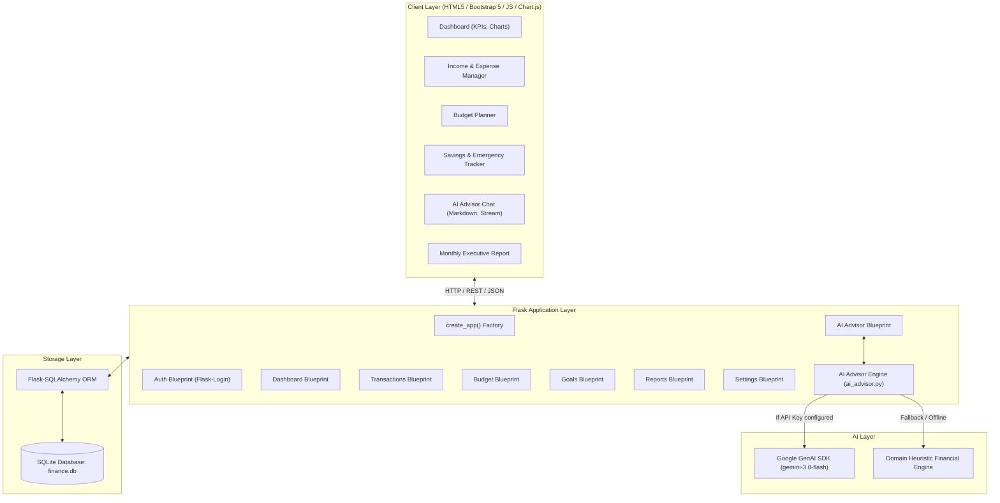
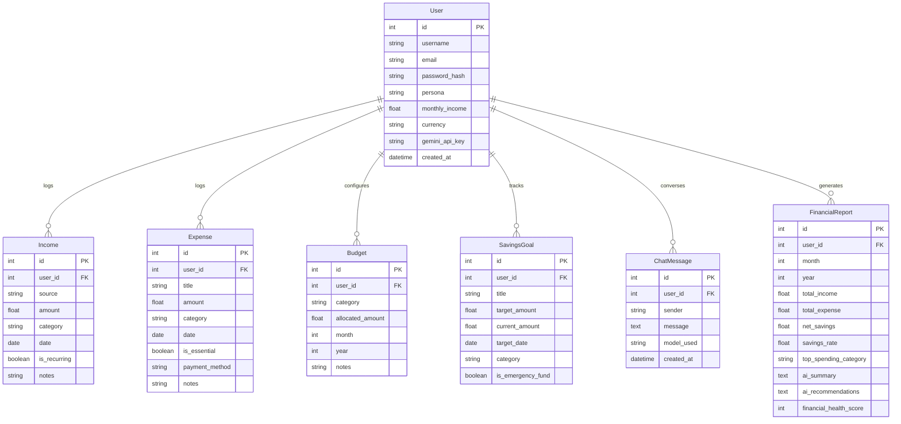

# Personal Finance Advisor Bot
### AI-Powered Financial Planning Assistant

[](https://www.python.org/)
[](https://flask.palletsprojects.com/)
[](https://www.sqlite.org/)
[](https://ai.google.dev/)
[](https://getbootstrap.com/)
[](https://www.chartjs.org/)

---

## 📌 Project Overview

The **Personal Finance Advisor Bot** is an intelligent, full-stack personal financial planning assistant developed to help individuals take control of their finances with clarity, intelligence, and confidence. 

By integrating modern backend technologies with **Google Gemini AI**, the system enables users to:
- Record and categorize monthly income (salaries, client invoices, stipends, allowances).
- Log daily and weekly living expenses with essential vs. discretionary classification.
- Detect overspending across categories in real time.
- Generate automated, personalized budget plans adapted to user persona (50/30/20 rule, freelance buffer rule, student allowance model, household model).
- Establish and track progress toward savings goals and liquid emergency funds.
- Converse with a real-time **AI Financial Advisor Bot** grounded in live user data.
- Synthesize comprehensive monthly financial performance reports with health scores and strategic recommendations.

---

## 👩‍🏫 Mentor & Academic Details

- **Mentor**: Sai prathyusha Nagilla
- **Contact / Feedback Email**: `prathyusha+mentor@thesmartbridge.com`
- **Curriculum / Program**: SmartBridge / AICTE AI Financial Planning Capstone Project

---

## 📊 Project Statistics & Epic Mapping

| Metric | Target | Status |
|:---|:---:|:---:|
| **Total Epics** | **8** | ✅ Complete |
| **Total Tasks** | **15** | ✅ Complete |
| **Total Subtasks** | **0** | ✅ Clean Architecture |
| **Unit & Integration Tests** | **15** | ✅ 100% Passing |

### 🗂️ 8 Epics & 15 Tasks Breakdown

1. **Epic 1: Project Setup & Technical Architecture**
   - *Task 1*: Establish Python virtual environment, Flask application factory, and configuration system.
   - *Task 2*: Implement project folder structure, environment variable handling, and base templates.
2. **Epic 2: Database Modeling & Persistence**
   - *Task 3*: Design relational schema for Users, Incomes, Expenses, Budgets, Savings Goals, and Chat Records.
   - *Task 4*: Implement SQLAlchemy ORM models, relations, cascade deletes, and SQLite persistence.
3. **Epic 3: User Authentication & Multi-Persona Management**
   - *Task 5*: Build secure user registration, password hashing (`Werkzeug`), login/logout session handling (`Flask-Login`).
   - *Task 6*: Implement multi-persona profiles (Salaried Professional, College Student, Freelancer, Household Manager) with instant demo switchers.
4. **Epic 4: Income & Transaction Management**
   - *Task 7*: Develop multi-source income tracking supporting fixed wages, variable client invoices, and recurring schedules.
   - *Task 8*: Build daily/weekly expense logging with category classification and essential vs. discretionary tagging.
5. **Epic 5: Budget Planning Engine**
   - *Task 9*: Build category-level budget limit configuration and variance tracking.
   - *Task 10*: Implement real-time overspending alerts with visual indicators (Safe, Near Limit, Over Budget).
6. **Epic 6: Savings & Emergency Fund Management**
   - *Task 11*: Implement savings goals tracking with visual progress meters and milestone calculation.
   - *Task 12*: Build automated Emergency Fund benchmark calculator (3-to-6 months essential buffer).
7. **Epic 7: Gemini AI Advisor Integration**
   - *Task 13*: Integrate Google GenAI SDK (`google-genai` / `gemini-3.8-flash`) with financial prompt grounding and fallback heuristic intelligence.
   - *Task 14*: Build interactive real-time AI Advisor Chatbot interface with persona-tailored prompt suggestions.
8. **Epic 8: Analytics, Visualization & Monthly Financial Reporting**
   - *Task 15*: Develop interactive Chart.js visualizations (Category Doughnut, Income vs. Expense Trend) and monthly executive PDF/print financial performance reports.

---

## 🎭 Scenarios & Demonstration Guide

The platform includes built-in one-click demo loaders for all 4 required scenarios:

```
+-------------------------------------------------------------------------------+
|                        4 TESTABLE DEMO SCENARIOS                              |
+-------------------------------------------------------------------------------+
| Scenario 1: Salaried Professional (Alex Vance)                                |
|   - Income: $5,500/mo salary                                                  |
|   - Categories: Rent ($1,800), Food ($650), Transport ($300), Entertainment  |
|   - Highlights: Overspending in Entertainment ($480 > $350); 50/30/20 Plan    |
+-------------------------------------------------------------------------------+
| Scenario 2: College Student (Sam Rivera)                                      |
|   - Income: $850/mo (Allowance + Work-Study)                                  |
|   - Categories: Dorm contribution, Textbooks, Campus dining, Coffee           |
|   - Highlights: Essential vs Discretionary tracking, waste-reduction advice   |
+-------------------------------------------------------------------------------+
| Scenario 3: Freelancer / Contractor (Jordan Reed)                             |
|   - Income: Variable earnings from 3 distinct clients ($4,600)                |
|   - Categories: Software licenses, Cloud servers, Co-working pass             |
|   - Highlights: Fluctuating cashflow adaptation, 6-month emergency buffer     |
+-------------------------------------------------------------------------------+
| Scenario 4: Household Manager (Morgan Family)                                 |
|   - Income: Shared family income $7,200 ($4,200 Primary + $3,000 Partner)     |
|   - Categories: Groceries ($1,220), Utilities ($440), Child Education ($530)  |
|   - Highlights: Consolidated reporting, overruns in groceries & utilities    |
+-------------------------------------------------------------------------------+
```

*Tip: On the Sign-In page, click any of the "Scenario Demo" buttons to log in directly without typing credentials!*

---

## 🏗️ Technical Architecture

### Architecture Diagram



### Database Entity Relationship Diagram



---

## 💻 System Requirements

### Hardware Requirements
- **Processor**: Intel Core i5 (8th Gen or above) / AMD Ryzen 5 or equivalent
- **RAM**: Minimum 8 GB (Recommended: 16 GB)
- **Storage**: Minimum 256 GB SSD (or 500 GB HDD)
- **Internet**: High-speed internet connection (minimum 10 Mbps)

### Software Requirements
- **Operating System**: Windows 10/11, macOS (Monterey+), or Linux (Ubuntu 20.04+)
- **Python**: Version 3.8 or above (Compatible with Python 3.14)
- **Web Browser**: Google Chrome, Mozilla Firefox, or Microsoft Edge
- **Code Editor**: Visual Studio Code or any preferred IDE
- **Version Control**: Git

---

## 🚀 Installation & Setup Instructions

### 1. Clone or Open the Workspace
```bash
cd c:\Users\Lenovo\OneDrive\Desktop\bot
```

### 2. Verify Python & Dependencies
Ensure Python 3.8+ is installed:
```bash
python --version
pip --version
```

Install required packages:
```bash
pip install -r requirements.txt
```

### 3. Configure Environment Variables
Copy `.env.example` to `.env` (already created):
```env
SECRET_KEY=dev-secret-key-change-in-production-12345
GEMINI_API_KEY=your_gemini_api_key_here
DATABASE_URL=sqlite:///finance.db
FLASK_ENV=development
```
*(Note: If you don't have a Gemini API key yet, the app runs automatically using its high-fidelity Heuristic Financial Intelligence Engine. You can also paste your Gemini API key anytime via the in-app Settings page).*

### 4. Run the Application
Launch the Flask development server:
```bash
python run.py
```

Open your browser and navigate to:
```
http://127.0.0.1:5000/
```

### 5. Running the Automated Test Suite
Execute the 15 comprehensive unit and integration tests:
```bash
python -m pytest -v
```

---

## 🔌 API & Route Structure

| Route | Method | Description |
|:---|:---:|:---|
| `/` | `GET` | Main financial dashboard with KPIs, charts, and alerts |
| `/login` | `GET, POST` | User authentication & sign-in |
| `/register` | `GET, POST` | Account creation with persona selection |
| `/logout` | `GET` | User session termination |
| `/demo-login/<persona_key>` | `GET` | 1-Click scenario switcher (`salaried`, `student`, `freelancer`, `household`) |
| `/transactions/income` | `GET, POST` | Multi-source earnings logger & filter view |
| `/transactions/income/delete/<id>` | `POST` | Delete income record |
| `/transactions/expenses` | `GET, POST` | Expense logging with essential/discretionary tag |
| `/transactions/expenses/delete/<id>` | `POST` | Delete expense entry |
| `/budget/` | `GET, POST` | Category budget limits and variance tracking |
| `/budget/apply-ai-plan` | `POST` | Auto-apply AI recommended budget plan |
| `/budget/delete/<id>` | `POST` | Remove category budget limit |
| `/goals/` | `GET, POST` | Savings goals & emergency fund benchmarks |
| `/goals/contribute/<id>` | `POST` | Deposit capital toward savings milestone |
| `/goals/delete/<id>` | `POST` | Delete savings goal |
| `/advisor/` | `GET` | Interactive AI Financial Advisor chatbot view |
| `/advisor/chat` | `POST` | Real-time chat API endpoint (JSON) |
| `/advisor/clear` | `POST` | Reset conversation history |
| `/reports/` | `GET` | Monthly financial report & health score generator |
| `/reports/save` | `POST` | Save monthly report snapshot to database |
| `/settings/` | `GET, POST` | Profile, persona, currency, and Gemini API key configuration |

---

## 🛡️ License & Acknowledgments

Developed as part of the AI Financial Planning capstone curriculum under the mentorship of **Sai prathyusha Nagilla** (`prathyusha+mentor@thesmartbridge.com`). Built with Flask, SQLAlchemy, SQLite, and Google Gemini AI.
